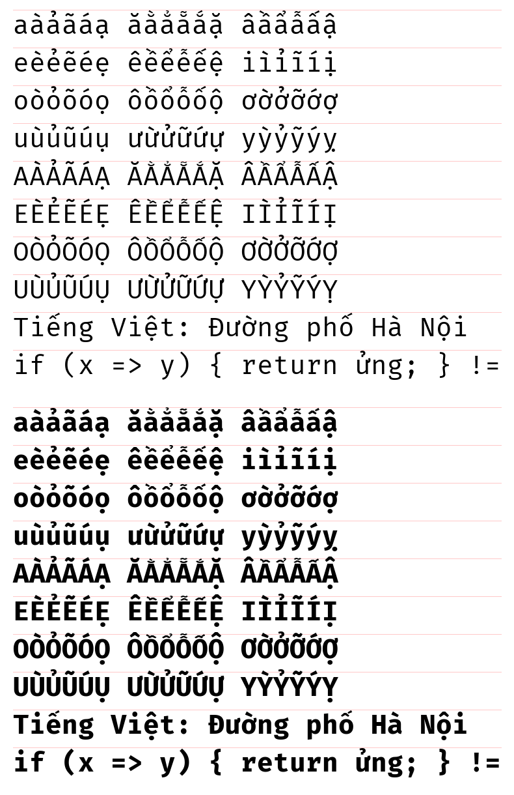

# Fira Code VN

[Fira Code](https://github.com/tonsky/FiraCode) bổ sung đầy đủ tiếng Việt — 134/134 chữ có dấu (thường và hoa), giữ nguyên ligature và các biến thể ký tự của Fira Code.

*Fira Code with full Vietnamese support (all 134 precomposed Vietnamese letters). Ligatures and character variants are unchanged.*



## Cài đặt

Tải các file trong [`fonts/ttf`](fonts/ttf) → chuột phải → **Install** (hoặc *Install for all users* nếu muốn dùng trong cmd kiểu cũ).

Tên font khi chọn trong ứng dụng: **`Fira Code VN`** (các kiểu: Light, Regular, Retina, Medium, SemiBold, Bold).

VS Code:

```json
"editor.fontFamily": "'Fira Code VN', monospace",
"editor.fontLigatures": true
```

## Đã làm gì

Fira Code 6.2 thiếu 46/67 chữ tiếng Việt (ơ ư, dấu hỏi, dấu nặng và các dấu chồng như ấ ầ ẩ ẫ ậ). Bản này:

- **Dùng lại dấu của chính Fira Code**: mũ (â ê ô), trăng (ă), sắc, huyền, ngã; dấu nặng làm từ dấu chấm của Fira Code.
- **Lấy từ [Fira Sans](https://github.com/mozilla/Fira)** (cùng họ Fira) những gì Fira Code không có: dấu hỏi và móc của ơ/ư, chỉnh cỡ cho khớp.
- **Dấu chồng kiểu Việt**: sắc/hỏi đặt chéo bên phải dấu mũ, huyền bên trái, ngã ở trên; với dấu trăng thì thanh ở trên. Chữ hoa có dấu chồng nằm gọn trong chiều cao dòng để Windows không cắt dấu.
- Các chữ mới là glyph ghép (composite) với cờ giống hệt glyph gốc của Fira Code; toàn bộ font được hint lại bằng [ttfautohint](https://freetype.org/ttfautohint/) để rõ nét ở cỡ nhỏ (terminal 12–14 px).
- Đổi tên họ font thành `Fira Code VN` để cài song song với Fira Code gốc.

## Hạn chế

- Dấu được ghép tự động bằng script, chưa được tinh chỉnh bằng tay như font do nhà thiết kế làm.
- Ở 12–13 px, các chữ có hai dấu (ấ, ể…) vẫn chật — giới hạn chung của mọi font ở cỡ này.
- Văn bản dạng tổ hợp (chữ + dấu rời U+0300…) chỉ hiển thị cơ bản; gõ dựng sẵn (mặc định của Unikey/EVKey) thì không ảnh hưởng.

## Build lại

Cần Python 3 trên Windows:

```powershell
.\scripts\build.ps1
```

Script tải Fira Code 6.2 và Fira Sans, chạy [`scripts/build_vn.py`](scripts/build_vn.py) cho từng kiểu chữ rồi hint lại bằng ttfautohint; kết quả ghi vào `fonts/ttf`.

## Giấy phép

[SIL Open Font License 1.1](LICENSE), như Fira Code và Fira Sans gốc.

- Fira Code — © 2014 The Fira Code Project Authors
- Fira Sans — © 2012-2015 The Mozilla Foundation and Telefonica S.A.

Đây là bản sửa đổi không chính thức, không liên kết với các dự án gốc.
